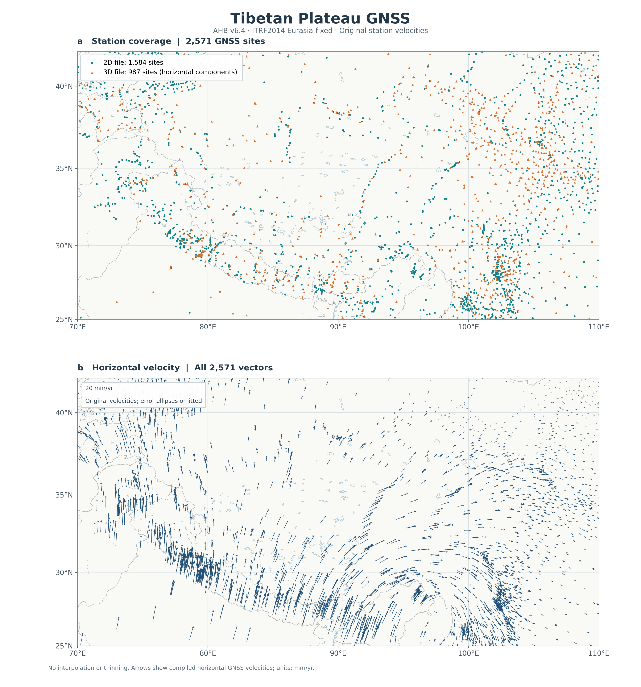
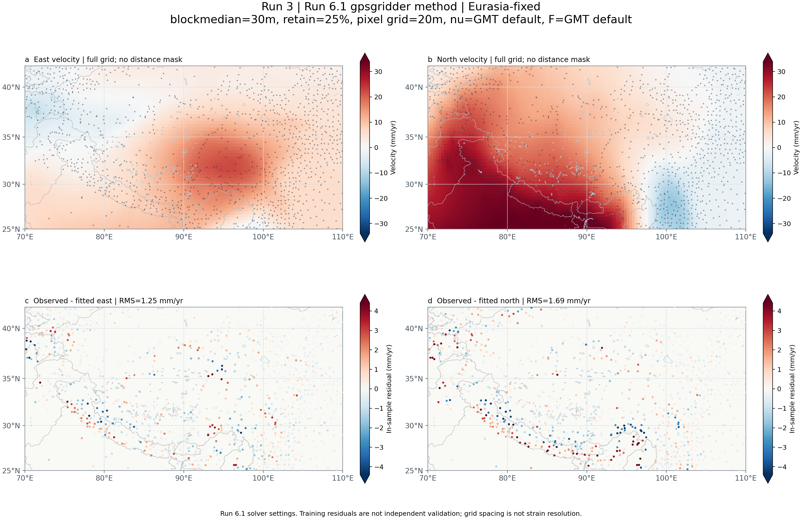
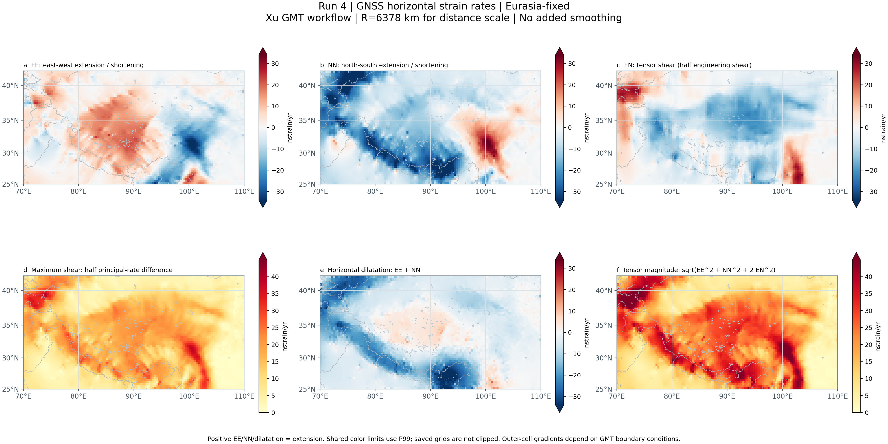
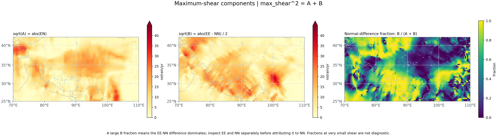
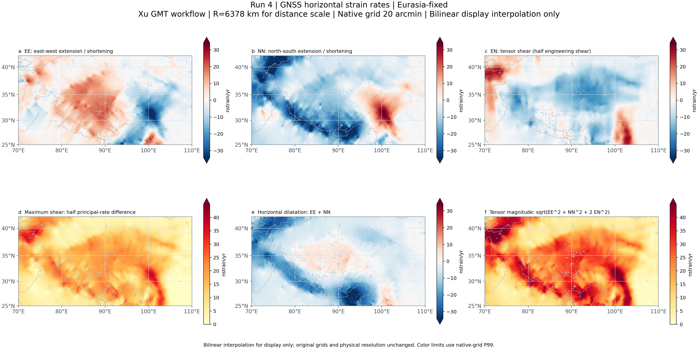

# 正式流程示例图

示例来自同一次正式处理，包含PNG预览和PDF版本。原始数据版本为AHB v6.4，参考系为欧亚固定。

| 参数 | 数值 |
|---|---|
| 研究区 | 70–110°E、25–42°N |
| 输入范围，含缓冲区 | 67–113°E、22–45°N |
| blockmedian | 30′ |
| 保留模态比例 | 25%，实际842/3370个 |
| 原始输入 / 分块代表点 | 3600 / 1685 |
| 输出速度网格 | 20′，120列×51行 |
| 应变率方法 | Xu GMT方向梯度及主应变率计算 |
| 应变率单位 | nstrain/yr |

详细参数和图件SHA256指纹见 [example_parameters.json](example_parameters.json)。

## 图件索引

| 图件 | PNG | PDF |
|---|---|---|
| run1：原始台站与水平速度 | [PNG](run1_gnss.png) | [PDF](run1_gnss.pdf) |
| run3：插值速度与代表点残差 | [PNG](run3_velocity_fit_eu.png) | [PDF](run3_velocity_fit_eu.pdf) |
| run4：原始20′网格的六分量应变率 | [PNG](run4_strain_eu.png) | [PDF](run4_strain_eu.pdf) |
| run4：最大剪切率贡献分解 | [PNG](run4_shear_contributions_eu.png) | [PDF](run4_shear_contributions_eu.pdf) |
| run5：双线性显示插值后的六分量图 | [PNG](run5_strain_display_bilinear.png) | [PDF](run5_strain_display_bilinear.pdf) |

## 原始GNSS

图中展示研究区内2571个原始GNSS台站的位置和水平速度；没有分块或插值。

## 插值速度场

上排为东、北速度，单位mm/yr；下排为研究区内代表点的观测减模型残差。这里的残差是拟合样本内误差，不是独立验证。

## 原始应变率网格

直接显示20′网格，保留网格色块。EE、NN、面膨胀率为正表示伸张，为负表示缩短；EN是张量剪切分量。

## 剪切贡献分解

最大剪切率满足 `max_shear² = EN² + (EE-NN)²/4`。右图为法向差项在平方剪切率中的占比；较大占比说明EE与NN的差异贡献较大，仍需分别检查EE和NN才能讨论NN缩短的作用。剪切率接近零处的比例不适合单独解释。

## 显示插值图

run5只对已经计算的应变率做双线性显示插值。它与上面的run4图使用相同原始数据和色标，原始20′网格及物理分辨率保持不变。

